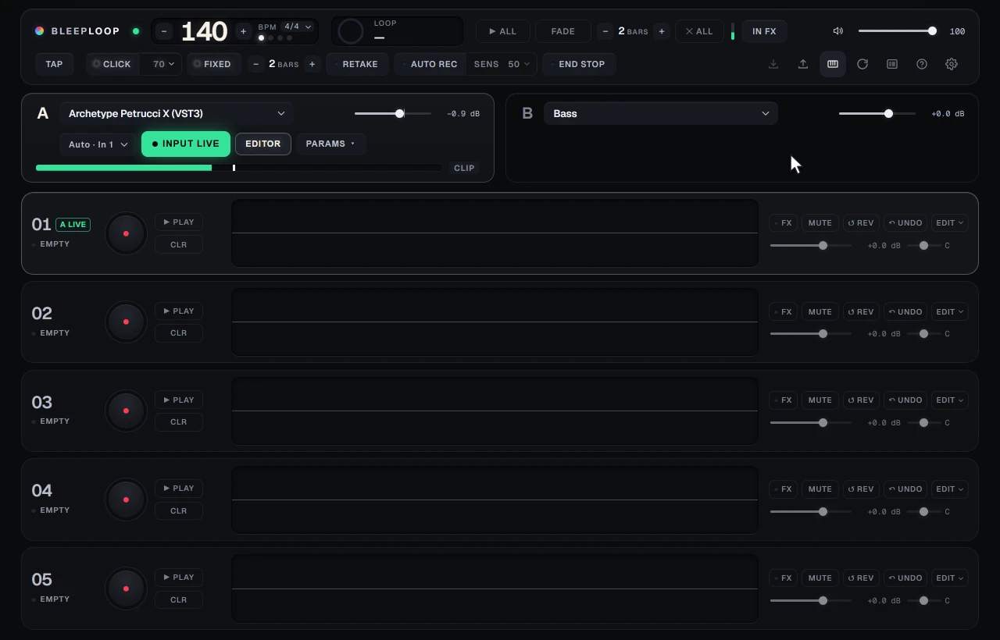
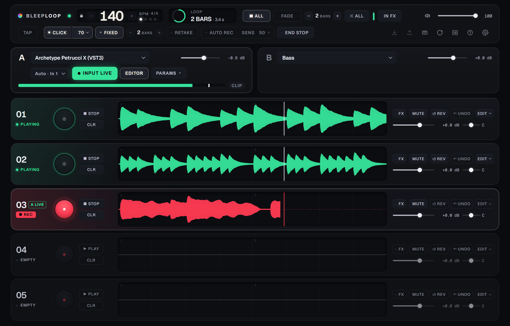

# BleepLoop

A looper for Windows that you play with a guitar. Load your own amp-sim plugin, play through it live
over ASIO, and build a song on five loop tracks, hands-free with a MIDI footswitch. Each take is placed
from the latency the ASIO driver reports, so there is no latency setting to tune. That has been
measured on one interface so far; see [Where it stands](#where-it-stands).

[](https://github.com/ikkeseb/bleeploop/releases/latest)

<!--
  VIDEO SLOT (60 s, with sound). Not recorded yet. When it exists: drag the .mp4 into any GitHub
  issue or comment box (no need to post it). GitHub uploads it and writes a
  https://github.com/user-attachments/assets/... link, which a README renders as a player with sound.
  Put that link on its own line here, delete this comment and keep the silent clip below as the fallback.
-->



*The clip above is silent. It is the app's interface clicked through a jam, with drawn waveforms.*

Download `BleepLoop_<version>_x64-setup.exe` from the latest release and run it. The installer is not
code-signed, so Windows SmartScreen warns on first run: choose "More info", then "Run anyway" (the
release carries the installer's sha256). After that the app tells you when a new version is out and updates
itself.

## What it needs

- Windows 10 or 11, 64-bit. The installer fetches the WebView2 runtime if the machine lacks it.
- An audio interface with an ASIO driver. WASAPI works as a fallback, but Windows and some drivers add
  latency they do not report, so WASAPI takes can land late (about 215 ms on the Focusrite the
  developer measured).
- Your own plugin for the guitar's sound: CLAP, VST3 or 64-bit VST2. BleepLoop hosts it; it is not an
  amp sim itself.
- Optional: a MIDI footswitch or keyboard. Without one, the computer keyboard runs the looper.

## Play it

1. Plug the guitar into your interface and start BleepLoop. In Audio Settings pick ASIO (and its
   driver, if you have more than one), the buffer size and the sample rate: 44.1 kHz, 48 kHz or the
   device's own. On WASAPI, Windows sets the rate.
2. Load your amp-sim into a slot, pick the slot's input and press GO LIVE. For an instrument with its
   own sound, set the other slot to Off, pick its input and GO LIVE: it plays dry.
3. Select a track with 1–5 and press Space to record. The first take gets a one-bar count-in, shown
   4-3-2-1 in 4/4; come in on the downbeat after it. The time signature beside BPM (4/4, 3/4, 6/8,
   12/8, 5/4) is picked before the first take; 6/8 and 12/8 count the dotted quarter.
4. Space again closes the take. After that, Space overdubs the selected track and Enter plays or stops
   it.
5. Help (the ? in the command bar) lists the rest.



## What is in it

- Five loop tracks with overdub and one-level undo, per-track reverse, mute, volume and pan, a count-in
  and fixed-length records. The click is locked to the loop grid, so it and the loops cannot drift apart.
- Two plugin slots (CLAP, VST3, 64-bit VST2) with their own editor windows. Each slot comes back at
  launch with the plugin and the settings you left it at.
- Effects per track (filter, pitch shift, stutter, delay, a shared reverb) and on the live input (echo,
  reverb, ring modulator).
- Six built-in synths, one of them a drum kit, for the other layers from a MIDI keyboard.
- Record, play, undo, mute, tap tempo, the click, FADE and the looper's other actions can be learned
  onto a MIDI footswitch, key or CC. A full-window stage view keeps
  the selected track, the bar, the beat and the count-in readable from where you stand.
- Your loops are saved once they have held still for two seconds and come back when you reopen; a
  crash before that save loses the last change. A jam exports as one zip: a WAV stem per track, a mix
  and each plugin's settings.

<details>
<summary><b>Everything it does</b></summary>

- 5-track looper with overdub and one-level undo, per-track reverse, mute, volume and pan, a one-bar
  record count-in and fixed-length record. The metronome is phase-locked to the loop grid, so the
  click and the loops cannot drift apart.
- AUTO REC arms the first track and starts its take when you start playing, instead of the count-in.
  Later tracks start on the loop grid either way; a take recorded with the loops stopped gets the
  count-in too and starts every track from the top.
- RETAKE keeps recording round the loop until you stop and keeps the last complete pass (the first
  track needs FIXED).
- END STOP makes STOP wait for the loop end; a second STOP press stops at once. FADE ends a song
  with a fade: every playing track fades out over 1, 2, 4 or 8 bars and stops on the bar line; the
  tracks keep their volumes, so PLAY ALL brings them back.
- DUB FEEDBACK (a track's FX drawer): how much of the layers under an overdub it keeps, pass by pass,
  so a loop can evolve instead of only piling up; 0 % replaces them.
- COPY duplicates a track, with its FX, volume, pan and mute, into the first empty track.
- A later take shorter than the loop repeats (tiles) across it, so every track has the loop's exact
  length. Keep playing past the loop, or set FIXED longer than it, and the take grows the loop in whole
  loops instead (multiply), and the other tracks repeat across it. TRIM keeps a track's first bars and
  repeats them across the loop; undo brings the whole take back.
- Local recovery: committed loops save once they have held still for two seconds and are restored when
  you reopen; a crash before that save loses the last change. Closing the app with a jam in progress
  asks first.
- Per-track FX: filter, pitch shift, tempo-synced stutter, feedback delay and a shared reverb send.
  Each one bypasses without a click.
- IN FX: a tempo-synced echo, a reverb and a ring modulator on the live input, heard and recorded,
  while the dry signal and a take's timing stay untouched.
- Stage view (B, or a learned pedal): a full-window visualizer of the loops in four looks,
  switched with V. Scope, the first, draws what the engine plays: the whole output with the guitar
  over it and each track after its FX. Orbit wraps each track's loop into a ring around the live
  input; Strata scrolls five ribbons past a now line; Ember draws the loops as five rings of light,
  with the guitar streaming into the one it writes. The selected track, the bar, the beat and the count-in stay readable from where you
  stand with the guitar.
- Six built-in synths, one of them a 16-voice GM drum kit.
- Two native CLAP/VST3/VST2 plugin slots with floating plugin editors; each slot reloads its last
  plugin at launch with the settings you left it at, never armed, and an exported session carries each
  slot's settings.
- Plugins are found in the standard CLAP, VST3 and VST2 folders and in any folder you add in Audio
  Settings. VST2 means 64-bit: a 32-bit one is recognised and listed there as not supported, not hosted.
- Guitar or line input monitored through your plugin inside the engine's callback. Takes are placed
  from the driver's reported latency.
- Share output mirrors the master, without the click, to a second output device while ASIO runs, for
  OBS, a browser or a voice chat (on WASAPI, capture the app's own output: it carries the click).
- MIDI controllers are read natively by the app, and a MIDI footswitch, key or CC can be
  learned onto a looper action in Audio Settings: a track action on the selected track or a fixed
  one, tap tempo, the click, END STOP, FIXED, RETAKE, AUTO REC, FADE and the input effects, and HOLD to
  record while the pedal is down. Without one, the computer keyboard plays notes and
  runs the transport (1-5 or the arrow keys to select a track, Space to record, Enter to play and
  stop, Backspace to undo; Help lists every key).
- Session export and import as one `.zip`: a WAV stem per track, a wet stereo master render and a
  `session.json`.
- Help → Manual → About this build names the version and commit, copies a diagnostics block for a bug
  report and opens the log folder.

</details>

## Where it stands

This is an early release from one maintainer, played by the maintainer and a few testers.

What held, measured on the developer's previous rig (a Focusrite Scarlett 2i2 3rd gen, ASIO,
44.1 kHz, a cable from the output back into the input):

- The guitar's round trip through the app and the interface was 8.1 ms at a 64-sample buffer and
  15.1 ms at 128.
- A take landed within 0.1 ms of where the driver's own latency report says it should, with no trim
  setting, and stayed put over ten minutes.
- An amp-sim plugin (Archetype Petrucci X) ran 120 s at buffer 128 and 256 with no dropouts.

What is rough:

- Only that one interface has had its timing and latency measured. The developer's current one (an
  Audient EVO 4) passes the release's smoke test, input included, but its timing is not measured yet.
  A report of how it runs on yours (interface, buffer size, what you heard) is welcome as an issue.
- Much of the feature list is proven by tests but has not yet been played by ear in a real jam.
  `STATUS.md` lists what has and has not.
- WASAPI takes land late on drivers that hide their latency (see above). ASIO is the path to use.
- The installer is unsigned, so SmartScreen warns on first run.

What it is not:

- Not a DAW: no timeline or arrangement. The mix is per-track volume, pan, mute and FX.
- Not an amp sim: bring your own plugin.
- Not a full MIDI host: notes, CC and pitch bend come in; no MIDI out, MIDI clock or SysEx.
- Not cross-platform: Windows only. The browser build is a silent test rig, not a web app.

## How it is built

One native audio engine in Rust, clocked by the audio interface, makes every sound: the looper, click,
synths, effects, limiter and both plugin slots run inside the driver's callback. The window is a
Tauri app with a SolidJS interface that sends commands to the engine and draws what it reports back.
Live audio never passes through the interface layer.

[`docs/ARCHITECTURE.md`](docs/ARCHITECTURE.md) holds the design decisions and the measurements behind
them. [`docs/VERIFY.md`](docs/VERIFY.md) and [`verify/README.md`](verify/README.md) cover how it is
tested: the engine's behaviour is rendered offline frame by frame in Rust tests, and the interface is
driven in a headless browser against a scripted engine. None of those reaches a real device, so feel
and latency are checked by playing and measuring the running app. The project is built with AI coding
agents; `AGENTS.md` and `STATUS.md` are the working notes for them.

### Build from source

Node >= 22.18 and pnpm 10 for the interface; for the full app also Rust (pinned in
`src-tauri/rust-toolchain.toml`), MSVC Build Tools 2022 and WebView2.

```bash
git clone https://github.com/ikkeseb/bleeploop.git
cd bleeploop
pnpm install
pnpm dev          # the interface alone in a browser, http://localhost:1420, silent
pnpm dev:wasapi   # the full app on WASAPI, no extra SDK needed
pnpm dev:asio     # the full app on ASIO (needs the ASIO SDK, below)
```

The ASIO build needs `LIBCLANG_PATH` set (cpal's `asio-sys` runs bindgen) and `CPAL_ASIO_DIR`
pointing at your own copy of the Steinberg ASIO SDK, which is not in this repo (`asio-sdk/` at its root
is gitignored for it). A binary built with it is GPLv3, see [License](#license).

<details>
<summary><b>All commands</b></summary>

| Command | What it does |
|---|---|
| `pnpm dev` | Vite dev server, frontend only (silent) |
| `pnpm dev:asio` | Full app, ASIO low-latency + native sample rate |
| `pnpm dev:wasapi` | Full app, WASAPI (no ASIO SDK needed) |
| `pnpm build` | `tsc --noEmit && vite build`, which the Tauri bundle depends on |
| `pnpm build:app` | Standalone release exe with ASIO (`tauri build --no-bundle --features asio`) |
| `pnpm check` | Typecheck, oxlint, the capability-boundary check, and the `verify/` guards. Also the pre-push hook |
| `pnpm verify` | Deterministic guards for the frontend's pure logic, file formats, the engine wire and the docs; no browser or hardware |
| `pnpm test:engine` | The engine's tests (`cargo test -p lf-engine`): looper, click, grid, synths and FX rendered offline, frame by frame |
| `pnpm probe <name>` | One browser probe against the real app on its own Vite server; `--ci` runs every CI probe, `--list` names them |
| `pnpm rust:check` | `cargo check` without and with ASIO, `cargo test`, then the check that keeps the engine crate free of host, device and plugin dependencies (Windows; the ASIO step needs the SDK) |
| `pnpm native:smoke` · `native:survey` · `native:swap` · `native:recall` | Launch the full app with a DEV plugin probe, print its verdict and stop (Windows, installed plugins) |

The `build-exe` workflow builds the ASIO installer on a clean Windows runner. A `v*` tag publishes the
GitHub Release with the installer, its sha256, the licence texts and the updater's manifest once the
build and its gates are green.

</details>

## Thanks

To [@MARTINWOBBLE](https://github.com/MARTINWOBBLE), who has tested BleepLoop more than anyone and
keeps sending bug reports, feedback and ideas.

## License

The source is MIT, see [`LICENSE`](LICENSE). The released installer is built with the Steinberg ASIO
SDK under its GPLv3 option, so that binary is GPLv3 as a whole. That is why each release ships
`GPL-3.0.txt` beside the installer.
[`THIRD-PARTY-NOTICES.md`](THIRD-PARTY-NOTICES.md) lists the dependency licences, and `licenses/` holds
the licence texts that ship with the installer.


ASIO is a registered trademark of Steinberg Media Technologies GmbH.
